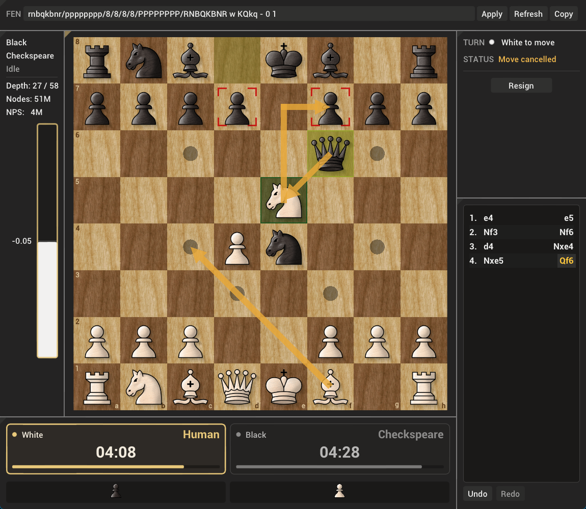
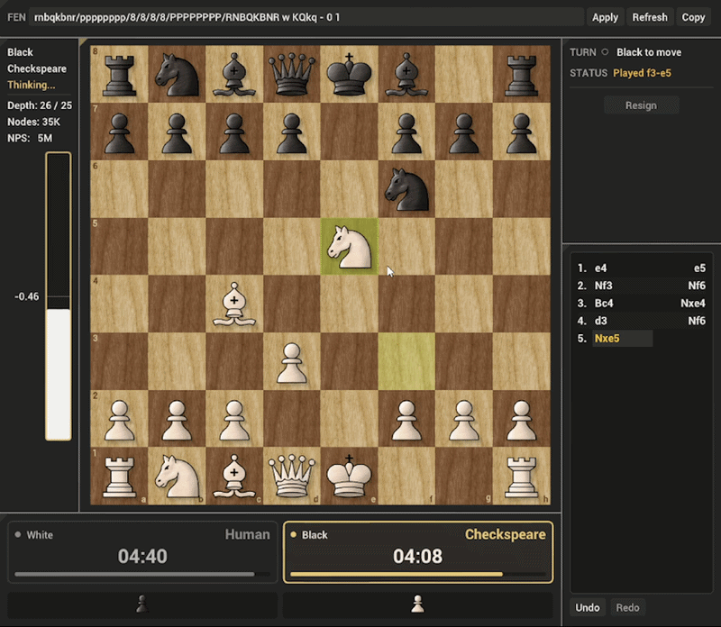

<div align="center">

# ♟️ Checkspeare

**A high-performance chess engine and standalone graphical interface, written in modern C++23.**

[](https://en.cppreference.com/w/cpp/23.html)
[](https://www.chessprogramming.org/UCI)


[Features](#features) · [Performance](#performance) · [Playing Strength](#playing-strength) · [Building](#building) · [Usage](#usage) · [Architecture](#architecture) · [Documentation](#technical-documentation)

</div>

---

Checkspeare combines optimized bitboard move generation, alpha-beta search, and handcrafted position evaluation. The engine and the GUI are fully independent: the engine runs in any UCI-compatible chess GUI, and the GUI can play human-vs-human or connect to any UCI engine.

<p align="center">
  
  <br>
  <sub><b>Checkspeare GUI</b>: main window with the interactive chessboard and game controls</sub>
</p>

<p align="center">
  
  <br>
  <sub><b>Checkspeare GUI</b>: gameplay demonstration with click-to-move piece movement</sub>
</p>

## Features

### Chess Engine

| Area | Details |
|---|---|
| **Move generation** | Bitboards with BMI2/PEXT sliding attacks where supported, Hyperbola Quintessence fallback |
| **Search** | Alpha-beta with iterative deepening, aspiration windows, quiescence search, transposition table, null-move and futility pruning, late-move reductions, check extensions |
| **Move ordering** | SEE, killer moves, history heuristic, countermoves, continuation history |
| **Opening book** | Polyglot (`.bin`) books, with weighted-random or best-move selection |
| **Evaluation** | Handcrafted and tapered: PeSTO piece-square tables, pawn structure, mobility, king safety |
| **Protocol** | UCI |

### Graphical Interface

| Area | Details |
|---|---|
| **Board** | Drag-and-drop or click-to-move input, smooth animations, board arrows |
| **Game tools** | Chess clocks with presets and custom increments, SAN move list, FEN loading, evaluation bar, engine-thinking panel, resignation |
| **Opponents** | Human vs. human, human vs. engine, or engine vs. engine, using the Checkspeare engine or any UCI engine |
| **Presentation** | Custom theme, fonts, piece textures, and sound effects |
| **Technology** | **SFML** for windowing and rendering, **Dear ImGui** for the interface |

## Performance

| Benchmark | Result | Notes |
|---|---|---|
| **Perft** | 119,060,324 nodes | Start position, depth 6, 752 ms |
| **Search speed** | 5.11 M nodes/second | Start position, depth 18, 64 MB hash |

**Test environment:** AMD Ryzen 5 5600X · MinGW-w64 UCRT GCC 14.2.0 · Release build (`-O3`, IPO/LTO) · PEXT enabled. Results vary with hardware, compiler, and build configuration.

## Playing Strength

BayesElo ratings from a 600-game match against Stockfish 19 limited to `UCI_Elo` 2900 (`SF2900`):

```text
Rank Name          Elo    +    - games score oppo. draws
   1 SF2900         39   12   12   600   62%   -39   35%
   2 Checkspeare   -39   12   12   600   38%    39   35%
```

Checkspeare scored 38% (35% draws), a 78 Elo deficit against this opponent.

**Conditions:** cutechess-cli · 60 s + 0.6 s per game · `komodo.bin` opening book · 64 MB hash · Ryzen 5 5600X, 16 GB RAM, Windows 11.

> [!NOTE]
> Stockfish's `UCI_Elo` is not directly comparable to FIDE or rating-list Elo, so this result describes this specific matchup only. Methodology and the exact match command are in the [technical documentation](#technical-documentation).

## Building

**Requirements:** a C++23 compiler (GCC, Clang, or MSVC), CMake 3.28+, and Git. SFML, Dear ImGui, ImGui-SFML, and Catch2 are fetched and built automatically on the first configure, which needs internet access.

```bash
git clone https://github.com/AbdullahAhmedTaman/Checkspeare.git
cd Checkspeare
cmake -S . -B build -DCMAKE_BUILD_TYPE=Release
cmake --build build --parallel
```

On Windows, use `cmake --build build --config Release --parallel` with Visual Studio or MinGW-w64.

### Building Specific Targets

By default, the build command above compiles everything. To build only one component, add `--target`:

| What to build | Command |
|---|---|
| **Engine only** | `cmake --build build --parallel --target CheckspeareEngine` |
| **GUI only** | `cmake --build build --parallel --target CheckspeareGUI` |

> [!NOTE]
> With multi-config generators such as Visual Studio, also add `--config Release`, e.g.
> `cmake --build build --config Release --parallel --target CheckspeareEngine`.

On Linux, SFML is built from source and needs its development packages. On Debian/Ubuntu:

```bash
sudo apt install build-essential cmake git \
    libx11-dev libxrandr-dev libxcursor-dev libxi-dev libudev-dev \
    libgl1-mesa-dev libfreetype-dev libopenal-dev libvorbis-dev libflac-dev
```

### Build Options

| Option | Default | Description |
|---|---|---|
| `USE_PEXT` | `ON` | PEXT sliding attacks (x86-64 with BMI2 only; ignored on other targets). Use `-DUSE_PEXT=OFF` on CPUs without BMI2 |
| `ENGINE_X86_ARCH` | `x86-64-v3` | `-march` value for PEXT builds on GCC/Clang (`x86-64-v3`, `native`, or empty for `-mbmi2` only) |
| `ROOK_COMPRESSED` | `OFF` | 16-bit compressed rook table (requires `USE_PEXT`) |

## Usage

### Graphical Interface

Run `CheckspeareGUI` from `build/bin/` (multi-config generators such as Visual Studio add a configuration subfolder). In the setup dialog, choose **Human** or **Engine** for each side and a time control. Choosing Human for both sides starts a two-player game; by default an Engine side uses the `CheckspeareEngine` executable next to the GUI, and you can point it at any other UCI engine.

### Chess Engine

Use `CheckspeareEngine` through the GUI, or add it to any UCI-compatible GUI such as [Arena](http://www.playwitharena.de/) or [Cute Chess](https://cutechess.com/). It also runs directly in a terminal:

```text
uci
isready
position startpos
go depth 8
```

| UCI option | Default | Description |
|---|---|---|
| `Hash` | `64` | Transposition table size in MB (1–32768) |
| `BookFile` | `book.bin` | Path to a Polyglot opening book |
| `BookMode` | `Weighted` | `Weighted` picks book moves by weighted random choice; `Best` always plays the highest-weighted move |

On startup the engine tries to load `book.bin` from its working directory; without a book it simply searches. When the book contains the current position, the engine plays the book move immediately.

### Testing

```bash
ctest --test-dir build --output-on-failure
```

## Architecture

The engine (`engine/`) is a standalone UCI executable; the GUI (`gui/`) is an SFML/ImGui application that talks to engines over UCI.

```text
Checkspeare/
├── engine/
│   ├── src/
│   │   ├── board/       # Board representation and move generation
│   │   ├── book/        # Polyglot opening book
│   │   ├── eval/        # Position evaluation
│   │   ├── search/      # Search, move ordering, and heuristics
│   │   └── uci/         # UCI protocol handling
│   └── tests/           # Engine tests (including perft)
├── gui/
│   ├── assets/          # Fonts, themes, and piece textures
│   ├── src/
│   │   ├── assets/      # Asset management
│   │   ├── audio/       # Audio handling
│   │   ├── controller/  # Application controllers
│   │   ├── engine/      # UCI subprocess communication
│   │   ├── game/        # Game and board logic
│   │   ├── input/       # User input handling
│   │   └── ui/          # ImGui interface components
│   └── tests/           # GUI tests
└── docs/             # Technical documentation and images
```

## Technical Documentation

For the architecture, bitboard optimizations, search algorithms, evaluation design, and implementation decisions, see the accompanying document:

**[Checkspeare Technical Documentation (PDF)](docs/Checkspeare-Technical-Documentation.pdf)**